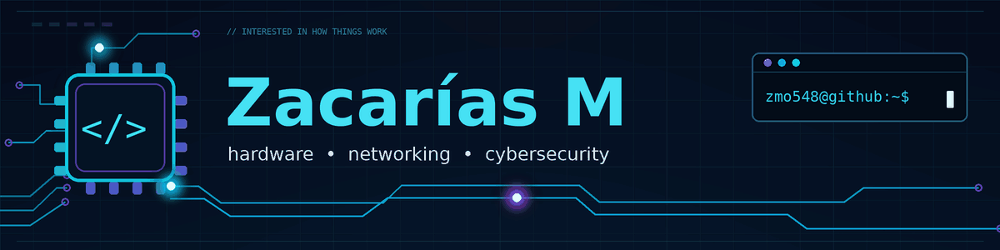

  

  
<em>Curious by nature. Hands-on by habit.</em>

### 👋 A little about me

I'm **Zacarías**, a Computer Engineering student who enjoys figuring out how things work — whether it's a computer's hardware, a network, or a piece of software.

I like tinkering, troubleshooting and learning by trying things out. This is my corner of GitHub to experiment and share what I discover along the way.

### 🧰 My toolbox

**Languages**

**Tools & systems**

### 🧭 Things that catch my interest

`Hardware & tuning` · `Networking` · `Cybersecurity` · `Cloud & systems`

---

Always exploring. Always learning. ⚡

