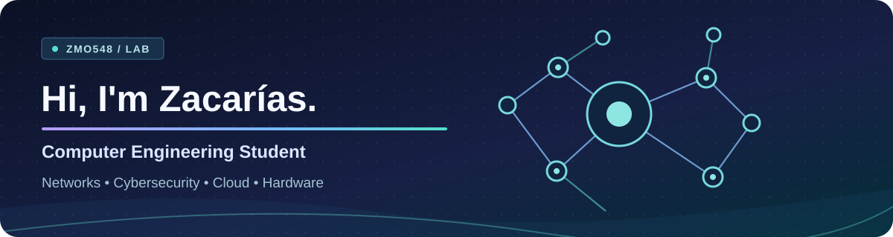

<div align="center">
  

  <p><strong>Building, testing and learning — from hardware to software.</strong></p>

  <a href="https://github.com/zmo548"></a>
  
  
</div>

## 👋 A little about me

I'm a final-year **Computer Engineering** student at the **University of Almería (Spain)**, specializing in Information Technologies. I enjoy understanding how things work — from CPU performance and computer networks to system security and cloud infrastructure.

My hands-on experience includes **full-stack web development**, **SQL/MySQL**, Linux-based security labs and team projects using Git/GitLab. My focus is broad: I like solving technical problems and learning the tools each challenge requires.

```yaml
profile: zmo548
interests: [networking, cybersecurity, cloud, systems, hardware]
hands_on: [full-stack development, SQL, Linux labs, hardware benchmarking]
currently_learning: [AI agents for CTF challenges, Ignition SCADA]
```

## 🧰 Tech stack & tools

**Programming & development**


**Systems, networking & cloud**


**Cybersecurity — academic lab experience**


## 🔬 Selected work

> These are real academic projects and internship experiences. Their code or write-ups will be linked here when they are ready to publish.

### 🖥️ Hardware performance & tuning

Compared CPU configurations using **Cinebench benchmarks, overclocking and undervolting**. The tested desktop configurations scored **10,770 vs. 13,219 Cinebench multi-core points** (**+22.7% difference between profiles**). This compares two configurations; it is not a claim of a universal performance gain.

### 🔐 Firmware security assessment

Used **CHIPSEC** to inspect **BIOS/UEFI, SPI flash and SMM/SMRAM** security controls, documenting configuration checks and potential firmware-protection weaknesses in an academic environment.

### 🔎 Memory forensics

Investigated a virtual-machine memory image with **Volatility 2/3**. Identified processes and recovered the required text evidence using memory-dump analysis and command-line tools.

### 💻 Full-stack development | Cuberty (2026)

Contributed to a client web application and administration panel, including user authentication, product management and **MySQL** database work. Also took part in early **SQL/API** and scheduling-algorithm exploration using a dataset of **60,000+ records**.

## 📚 Cisco Networking Academy

Completed CCNAv7 coursework:

- **Introduction to Networks** (2023)
- **Switching, Routing and Wireless Essentials** (2024)
- **Enterprise Networking, Security and Automation** (2024)

<sub>These are Cisco Networking Academy courses, not a claim of having passed the separate CCNA certification exam.</sub>

## 🚧 What I'm exploring now

- **AI agents for cybersecurity and CTFs** — learning and experimenting; not presented as production experience.
- **Ignition SCADA** — independent learning in industrial monitoring and automation.
- **Open technical write-ups** — preparing reproducible documentation from projects and labs.

---

<div align="center">
  <sub>Learn. Build. Test. Document. · <a href="https://github.com/zmo548">github.com/zmo548</a></sub>
</div>
